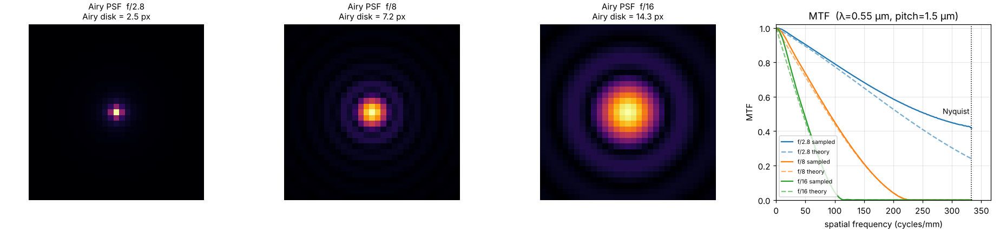
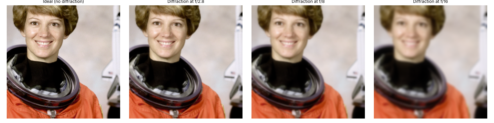
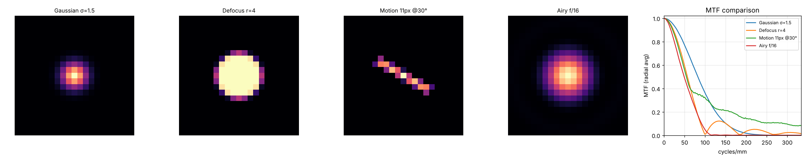
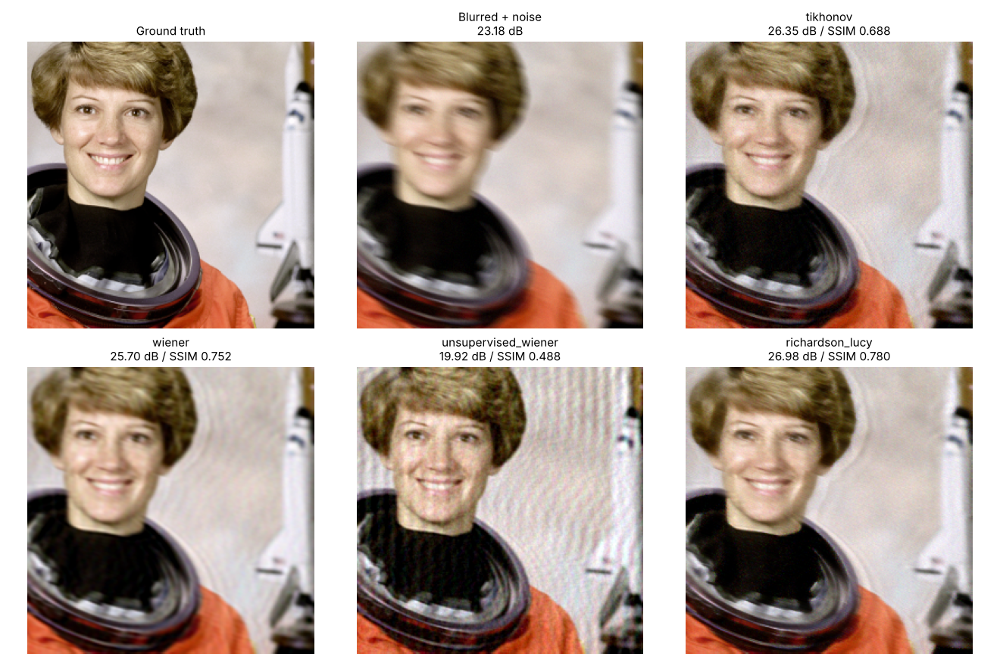
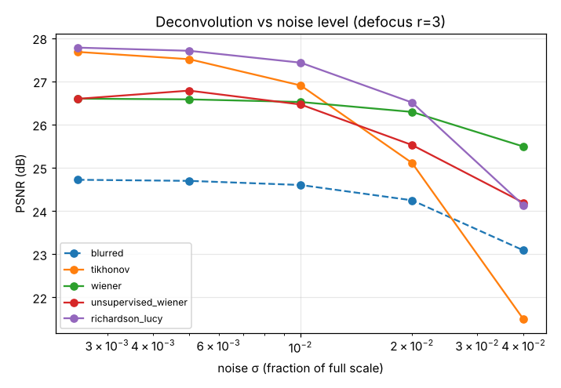
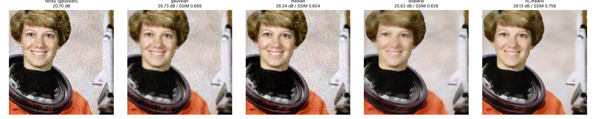
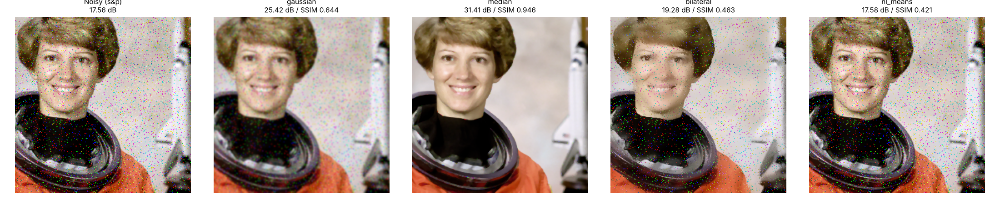
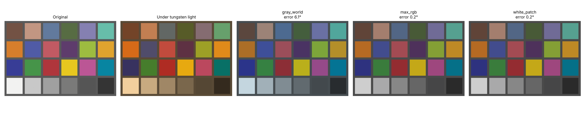

# Computational Imaging Toolkit: PSF/MTF Modelling, Deconvolution and Colour Constancy

A Python toolkit that models how a camera's **optics and sensor degrade an image**, then restores it. It covers diffraction, defocus and motion PSFs, MTF analysis, regularised deconvolution, noise filtering and white balance. Every algorithm is scored against ground truth (PSNR, SSIM, angular error), so the trade-offs show up as numbers.

> Started as an ECSE 544 (Computational Photography) portfolio. Rebuilt as a tested, reproducible package with a command line. The original course scripts are kept in [`legacy/`](legacy/).

---

## Why this matters for optics and imaging roles

Optical engineers use a few core ideas every day: the image-formation model, PSF, MTF, the Nyquist limit, diffraction vs. f-number, and the noise vs. resolution trade-off. This project puts each one into working code and checks it against theory:

| Optics concept | Where it is in the code | What the project shows |
|---|---|---|
| Image formation `g = h ⊛ f + n` | `deblur.blur`, `add_gaussian_noise`, `add_poisson_noise` | Simulates read noise and photon shot noise |
| Diffraction-limited PSF (Airy) | `psf.airy_psf(λ, N, pixel_pitch)` | Airy disk grows from 2.5 px at f/2.8 to 14.3 px at f/16 |
| MTF, MTF50, cutoff frequency | `psf.mtf_from_psf`, `psf.diffraction_mtf`, `psf.mtf50` | Sampled MTF matches theory within 0.01 (unit test) |
| Sampling, Nyquist, aliasing | `experiments.exp_psf_mtf` | f/2.8 PSF on 1.5 µm pixels is undersampled, so aliasing lifts the measured MTF near Nyquist |
| Defocus (circle of confusion), motion blur | `psf.defocus_psf`, `psf.motion_psf` | PSF gallery with MTF comparison |
| Inverse problems and regularisation | `deblur.tikhonov / wiener / richardson_lucy` | Noise sweep shows where each method breaks down |
| Radiometry and colour (von Kries) | `color.py` + linear-sRGB handling | Illuminant estimation scored in degrees of angular error |

---

## Results

All figures and tables are produced by one command (`python -m optics_imaging demo`) and saved in [`results/`](results/).

### 1. Diffraction: PSF and MTF vs. f-number (λ = 0.55 µm, 1.5 µm pixels)



| f-number | Airy diameter | Cutoff (cyc/mm) | MTF50 (cyc/mm) |
|---|---|---|---|
| f/2.8 | 3.8 µm = 2.5 px | 649 | 256 |
| f/8 | 10.7 µm = 7.2 px | 227 | 91 |
| f/16 | 21.5 µm = 14.3 px | 114 | 48 |

**What this shows:** the sensor's Nyquist frequency is 333 cyc/mm. From about f/5.5 onward the optical cutoff (1/λN) falls below Nyquist, so stopping down costs resolution regardless of lens quality. That is the diffraction limit. At f/2.8 it goes the other way: the PSF is smaller than about two pixels, so it is undersampled. Aliasing then folds energy back and the measured MTF near Nyquist (0.42) sits above theory (0.24). The theory curve already includes the pixel-aperture sinc.




### 2. Deconvolution (known PSF, noise σ = 0.01)



| Blur | Method | PSNR (dB) | SSIM |
|---|---|---|---|
| Defocus r = 3 px | *blurred input* | 25.64 | 0.800 |
| | Tikhonov (α = 0.02) | 27.95 | 0.784 |
| | Wiener (balance = 0.05) | 27.86 | **0.867** |
| | Unsupervised Wiener | 27.03 | 0.641 |
| | Richardson–Lucy (20 it.) | **28.62** | 0.857 |
| Motion 11 px | *blurred input* | 23.19 | 0.713 |
| | Tikhonov | 26.35 | 0.688 |
| | Wiener | 25.70 | 0.752 |
| | Unsupervised Wiener | 19.92 | 0.488 |
| | Richardson–Lucy | **26.98** | **0.780** |



**What this shows:** deconvolution amplifies the frequencies where the MTF is small, and that is where the noise lives. When the regularisation is fixed, Tikhonov drops *below the blurred input* at high noise. Wiener degrades the least. The regularisation strength has to follow the sensor's SNR. The unsupervised (Bayesian) Wiener under-regularises here and leaves visible ringing. It would need a better image prior.

### 3. Denoising

| Noise | Best method | PSNR: noisy → denoised |
|---|---|---|
| Gaussian (σ ≈ 0.1) | Non-local means | 20.7 → **29.1 dB** |
| Salt & pepper (5 %) | Median 3×3 | 17.6 → **31.4 dB** (SSIM 0.95) |

Linear filters spread impulse noise around instead of removing it. Rank filters (median) get rid of it, which is how hot and dead pixels are corrected on real sensors.




### 4. White balance / colour constancy

Test setup: a synthetic 24-patch colour chart in **linear RGB**, lit by a known illuminant. Error is the angle between the estimated and true illuminant colour.

| Illuminant | Gray World | Max-RGB | White-Patch Retinex |
|---|---|---|---|
| Tungsten 2850 K | 6.1° | 0.2° | 0.2° |
| Shade 7500 K | 7.2° | 0.3° | 0.3° |
| Green fluorescent | 6.8° | 0.2° | 0.2° |



The chart includes a white patch, which is the best case for Max-RGB and White-Patch. Gray World fails because the chart's average colour is not neutral. On real photos with no white surface, Max-RGB and White-Patch become less reliable (see `06_white_balance_photo.png`).

### 5. Tone tools

Histogram matching ("look transfer") and luminance-targeted contrast enhancement: `07_histogram_match.png`, `08_targeted_enhance.png`.

---

## How to run

### 1. Get the code
```bash
git clone https://github.com/ahntun20/image_processing_photography.git
cd image_processing_photography
```

### 2. Create an environment (Python 3.10+)
```bash
python -m venv .venv
source .venv/bin/activate          # Windows: .venv\Scripts\activate
pip install -r requirements.txt
```

### 3. Run the tests (about 1 s)
```bash
python -m pytest -q                # 11 physics/correctness checks
```

### 4. Reproduce every figure and table (about 15 s)
```bash
python -m optics_imaging demo              # writes results/*.png, *.md, *.csv
python -m optics_imaging demo --quick      # skips the noise sweep
```
Test images are generated automatically into `data/` from scikit-image's bundled samples, so there is nothing to download.

### 5. Use it on your own photos
```bash
# Deblur a real photo (pick the PSF that matches the blur)
python -m optics_imaging deblur -i photo.jpg --psf gaussian --sigma 1.5 --method richardson_lucy
python -m optics_imaging deblur -i photo.jpg --psf motion --length 15 --angle 30 --method wiener

# Simulate a degradation on a sharp image, then restore it
python -m optics_imaging deblur -i sharp.jpg --simulate --psf defocus --radius 3

# Denoise, white-balance, match a look
python -m optics_imaging denoise -i noisy.jpg --method nl_means
python -m optics_imaging wb      -i indoor.jpg --method white_patch
python -m optics_imaging match   -i photo.jpg -r film_look.jpg

# Inspect a lens: diffraction PSF + MTF50 for f/11 on 1.2 µm pixels
python -m optics_imaging psf --psf airy --fnum 11 --pitch 1.2 --wavelength 0.55

python -m optics_imaging --help            # all options
```
Outputs go to `results/` unless you pass `-o`.

---

## Project structure

```
optics_imaging/
  psf.py          PSF models (Gaussian, box, defocus disk, motion, Airy) + MTF, MTF50, diffraction MTF
  deblur.py       forward model (blur, Gaussian/Poisson noise) + Tikhonov, Wiener, unsupervised Wiener, Richardson–Lucy
  denoise.py      Gaussian, median, bilateral, non-local means
  color.py        illuminant model + Gray World, Max-RGB, White-Patch Retinex
  enhance.py      histogram matching, targeted contrast enhancement
  metrics.py      PSNR, SSIM, angular error
  experiments.py  reproducible experiments -> results/
  __main__.py     command-line interface
tests/            unit tests (energy conservation, MTF vs theory, no-shift regression, ...)
results/          generated figures + metrics tables
legacy/           original ECSE 544 scripts
```

## Key equations

- **Image formation:** `g = h ⊛ f + n`, or in the frequency domain `G = H·F + N`. Here H is the OTF and |H| is the MTF.
- **Airy PSF:** `I(r) = [2 J₁(v)/v]²`, with `v = πr/(λN)`. First zero at `r = 1.22 λN`.
- **Diffraction MTF:** `MTF(s) = (2/π)[acos s − s√(1−s²)]`, with `s = f/f_c` and `f_c = 1/(λN)`.
- **Tikhonov:** `F̂ = H*G / (|H|² + α)`
- **Wiener:** `F̂ = H*G / (|H|² + Sₙ/S_f)`
- **Richardson–Lucy:** `f ← f · [hᵀ ⊛ (g / (h ⊛ f))]`. Maximum likelihood under Poisson noise.
- **Von Kries white balance:** `RGB_out = RGB_in · (mean(L) / L)`, where L is the estimated illuminant.

## Tuning

Default regularisation (α = 0.02, balance = 0.05, 20 RL iterations) was chosen by a parameter sweep at σ = 0.01. For noisier images, raise α or balance and use fewer RL iterations. For cleaner images, do the opposite.

## Fixes made to the original scripts

- `deblurred_3.py`: the PSF was zero-padded into the corner without being centred, which **shifted the output** by half a kernel width. Fixed in `deblur.psf2otf`, with a regression test.
- All FFT deconvolutions now run on reflect-padded images, which removes wrap-around ringing at the borders.
- White balance now runs in **linear** RGB. sRGB values are gamma-encoded, and multiplying them is not physically meaningful.
- `deblurred.py` resized the image to HD and then processed the unresized one. `color_correction.py` compared images of different sizes. Both are fixed by the shared pipeline.
- Scripts used `cv2.imshow` / `plt.show()` and hard-coded filenames. They now save figures headlessly and take inputs from the command line.

## Limitations and next steps

- **Non-blind only.** The PSF must be known. Next: blind deconvolution or PSF estimation from a slanted edge (ISO 12233 SFR).
- Measure a **real lens**: photograph a slanted-edge target, compute its MTF, and compare it with the Airy model.
- Add Zernike-aberration PSFs (defocus, astigmatism, coma) through a pupil-function FFT.
- Add a raw-sensor pipeline (Bayer demosaicing, black level, noise calibration from flat fields).
- Compare against a learned denoiser or deblurrer (e.g., a small U-Net).

## Skills demonstrated

**Optics and imaging science:** PSF and OTF/MTF modelling, diffraction limits, sampling and aliasing, sensor noise models (shot and read noise), radiometric linearity and colour constancy, image-quality metrics.
**Signal processing:** 2-D FFT, convolution, inverse problems, regularisation (Tikhonov, Wiener, Bayesian), iterative maximum-likelihood estimation, linear vs. non-linear filtering.
**Software:** Python, NumPy, SciPy, scikit-image, Matplotlib, a modular package with a CLI, unit tests that check results against analytic theory, reproducible experiments.

## Credits

Test images come from scikit-image's bundled sample data (`astronaut`, `coffee`, `chelsea`).
